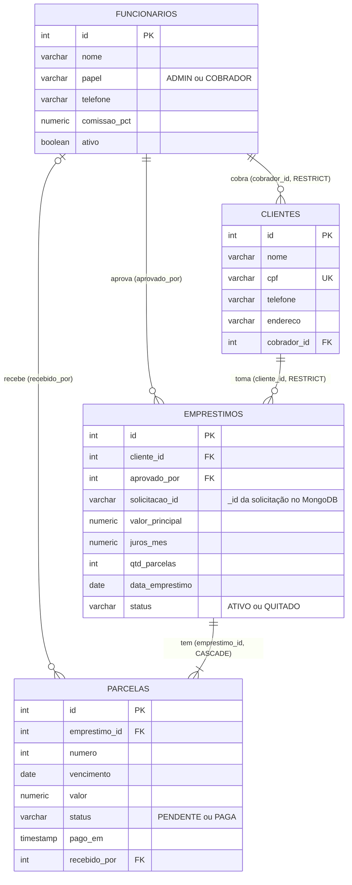

# Sistema do Agiota: Trabalho Final de Banco de Dados II

## Integrantes

- _Gustavo Machado Alves_


## Tema da aplicação

Sistema de controle de agiotagem. **O tema é fictício, criado só para fins acadêmicos.**

- **Cliente**: pede dinheiro emprestado, acompanha a solicitação e as parcelas.
- **Agiota (admin)**: analisa as solicitações, aprova ou recusa, gerencia cobradores, clientes e empréstimos.
- **Cobrador**: tem uma carteira de clientes, registra pagamentos e ocorrências de cobrança.

## Linguagem utilizada

Python 3.10+ (programa de terminal), com `psycopg2-binary`, `pymongo` e `python-dotenv`.

## SGBD relacional

PostgreSQL 16. O banco não relacional é o MongoDB 7.

## Como executar

### 1. Subir os bancos com Docker (recomendado)

```bash
docker compose up -d
```

Na primeira subida, o PostgreSQL roda sozinho `sql/01_schema.sql` e `sql/02_seed.sql`, e o MongoDB roda `mongo/setup.js`.

> Os scripts de inicialização só rodam quando o volume está vazio. Para recriar os bancos do zero:
> `docker compose down -v` e depois `docker compose up -d`.

> Se a porta 5432 já estiver ocupada por outro PostgreSQL no seu computador, mude `PG_PORT` no `.env`
> (por exemplo `PG_PORT=55432`). O `docker-compose.yml` usa essa mesma variável.

### 1 (alternativa). Sem Docker

Com PostgreSQL e MongoDB instalados e rodando:

```bash
createdb agiota
psql -d agiota -f sql/01_schema.sql
psql -d agiota -f sql/02_seed.sql
mongosh agiota mongo/setup.js
```

### 2. Rodar a aplicação

```bash
python -m venv .venv
# Windows:  .venv\Scripts\activate
# Linux/Mac: source .venv/bin/activate
pip install -r requirements.txt
copy .env.example .env        # Linux/Mac: cp .env.example .env
python app/main.py
```

Rodar sempre a partir da raiz do projeto.

## Como os dois bancos são utilizados

| Banco | O que guarda | Quem usa |
|---|---|---|
| PostgreSQL | `funcionarios`, `clientes`, `emprestimos`, `parcelas` | Parcelas do cliente, CRUD de cobradores, clientes, empréstimos, rota e pagamentos do cobrador |
| MongoDB | `solicitacoes`, `ocorrencias_cobranca` | Solicitações do cliente, fila do agiota, recusa, diário de cobrança |

Funcionalidades que usam **os dois bancos juntos** (`app/integracao.py`):

1. **Aprovar solicitação**: lê a solicitação no MongoDB, cria cliente, empréstimo e parcelas no PostgreSQL numa transação, e depois marca a solicitação como `APROVADA` no MongoDB com o id do empréstimo. Não existe transação entre dois bancos diferentes, por isso a ordem escolhida foi: grava primeiro no banco que guarda o dinheiro.
2. **Ficha do devedor**: dados do cliente, empréstimo e parcelas (PostgreSQL, com `JOIN`) + últimas ocorrências, última promessa de pagamento e garantias da solicitação original (MongoDB).
3. **Relatório dos cobradores**: total recebido no mês e comissão (PostgreSQL, `SUM`) + ocorrências do mês por tipo (MongoDB, `aggregate`).

## Por que cada dado foi para cada banco

**PostgreSQL guarda o dinheiro e os vínculos obrigatórios.** Funcionários, clientes aprovados, empréstimos e parcelas são dados com estrutura fixa, que se relacionam entre si (parcela pertence a empréstimo, empréstimo pertence a cliente, cliente tem um cobrador) e que precisam de integridade: não pode existir parcela de empréstimo inexistente, não pode apagar cobrador que ainda tem clientes. Aprovar um empréstimo e gerar as parcelas precisa ser uma transação (tudo ou nada). Os relatórios usam `JOIN` e `SUM`.

**MongoDB guarda os dados de formato variável e o histórico.** A solicitação de empréstimo tem garantias diferentes para cada pessoa (um carro tem placa, um celular tem IMEI, uma joia não tem nenhum dos dois) e uma lista de referências de tamanho variável. O diário de cobrança tem ocorrências de tipos diferentes: uma promessa de pagamento tem valor e data prometida, uma ligação não tem. Forçar isso em tabelas exigiria várias tabelas auxiliares ou muitas colunas vazias. A solicitação também existe antes de a pessoa virar cliente, então não faz sentido ela estar presa às FKs do relacional.

## Modelo ER



Mais detalhes em [docs/modelo-er.md](docs/modelo-er.md).

Pontos importantes do schema:

- `ON DELETE RESTRICT` em `clientes.cobrador_id`: não deixa apagar cobrador que ainda tem clientes.
- `ON DELETE CASCADE` em `parcelas.emprestimo_id`: cancelar (apagar) um empréstimo apaga as parcelas junto.
- Parcela atrasada não é um status salvo: é `status = 'PENDENTE' AND vencimento < CURRENT_DATE`, calculado na consulta.
- Juros simples: `total = valor * (1 + juros/100 * parcelas)`, parcela vence a cada 30 dias, centavos de diferença na última.

## Validações do MongoDB (`$jsonSchema`)

As duas coleções são criadas com `validationLevel: "strict"` e `validationAction: "error"` (veja `mongo/setup.js`).
A aplicação **não valida nada no Python** de propósito: quem recusa os dados é o MongoDB.

### `solicitacoes`

| Campo | Regras |
|---|---|
| `nome` | obrigatório, string, `minLength: 3`, `maxLength: 100` |
| `cpf` | obrigatório, string, `pattern` de CPF com pontuação |
| `telefone` | obrigatório, string, `pattern` de celular |
| `endereco` | obrigatório, string, `minLength: 5` |
| `valor_solicitado` | obrigatório, `number`, `minimum: 100`, `maximum: 50000` |
| `parcelas_desejadas` | obrigatório, `int`, `minimum: 1`, `maximum: 24` |
| `renda_declarada` | opcional, `number`, `minimum: 0` |
| `status` | obrigatório, `enum: PENDENTE, APROVADA, RECUSADA` |
| `garantias[]` | `tipo` (`enum`), `descricao` obrigatórios; `valor_estimado` `minimum: 0`; `placa` e `imei` com `pattern` |
| `referencias[]` | `nome` e `telefone` (mesmo `pattern`) obrigatórios |
| `criado_em` | obrigatório, `date` |
| `emprestimo_id` | `int` ou `null` |
| `motivo_recusa` | `string` ou `null` |

### `ocorrencias_cobranca`

- Obrigatórios: `emprestimo_id`, `cliente_id`, `cobrador_id` (`int`), `tipo`, `data` (`date`).
- `tipo`: `enum: VISITA, LIGACAO, WHATSAPP, PROMESSA_PAGAMENTO, RECUSA`.
- `observacao`: string, `maxLength: 500`.
- `promessa`: objeto opcional com `valor` (`number`, `minimum: 1`) e `data` (`date`), ambos obrigatórios se o objeto existir.

### Expressões regulares, parte por parte

| Regex | Leitura |
|---|---|
| `^[0-9]{3}\.[0-9]{3}\.[0-9]{3}-[0-9]{2}$` (CPF) | 3 dígitos, ponto, 3 dígitos, ponto, 3 dígitos, hífen, 2 dígitos. Ex.: `123.456.789-00` |
| `^\([0-9]{2}\) 9[0-9]{4}-[0-9]{4}$` (telefone) | DDD de 2 dígitos entre parênteses, espaço, celular começando com 9, 4 dígitos, hífen, 4 dígitos. Ex.: `(53) 99123-4567` |
| `^[A-Z]{3}-?[0-9][A-Z0-9][0-9]{2}$` (placa) | 3 letras maiúsculas, hífen opcional, 1 dígito, 1 letra **ou** dígito, 2 dígitos. Aceita a antiga `ABC-1234` e a Mercosul `ABC1D23` |
| `^[0-9]{15}$` (IMEI) | exatamente 15 dígitos |

- `^` e `$`: começo e fim do texto. Sem eles, `"xx123.456.789-00xx"` também passaria.
- `\.`, `\(`, `\)`: ponto e parênteses literais. Sem a barra, `.` quer dizer "qualquer caractere" e `( )` formam um grupo.
- `{n}`: repete exatamente n vezes. `?`: o item anterior é opcional.

## Índices e justificativa

| Coleção | Índice | Por quê |
|---|---|---|
| `solicitacoes` | `{ status: 1, criado_em: 1 }` | A tela principal do agiota é a fila de pendentes em ordem de chegada. A consulta filtra por `status` e ordena por `criado_em`; o índice composto atende o filtro e a ordenação sem varrer a coleção inteira (o `explain` mostra `IXSCAN`). |
| `solicitacoes` | `{ cpf: 1 }` | O cliente acompanha, altera e cancela a própria solicitação informando o CPF. |
| `ocorrencias_cobranca` | `{ emprestimo_id: 1, data: -1 }` | A ficha do devedor e o cobrador sempre buscam as ocorrências de um empréstimo, das mais recentes para as mais antigas. |

## Roteiro da apresentação

| O professor pede | Onde mostrar |
|---|---|
| Acesso ao PostgreSQL | Menu 4, opção 1 (versão e contagem das tabelas) |
| Acesso ao MongoDB | Menu 4, opção 1 (versão e contagem das coleções) |
| Operações no PostgreSQL | Menu 2, opções 4 a 11 (CRUD de cobradores, clientes, empréstimos); Menu 3, opção 2 (pagamento) |
| Consulta com JOIN | Menu 2, opções 8 (clientes com cobrador), 10 (empréstimos); Menu 1, opção 5 (parcelas); Menu 3, opção 1 (rota) |
| RESTRICT e CASCADE | Menu 2, opção 7 excluindo o Jaiminho (falha); Menu 2, opção 11 (parcelas somem junto) |
| Operações no MongoDB | Menu 1, opções 1 a 4 (insert, find, update, delete); Menu 3, opções 3 a 5 |
| Integração entre os bancos | Menu 2, opções 2 (aprovar), 12 (ficha do devedor), 13 (relatório) |
| Validação `$jsonSchema` | Menu 4, opção 3 (lê o validador do próprio banco) |
| Inserir documento inválido | Menu 4, opção 2 (mostra cada regra que falhou); ou Menu 1, opção 1 digitando dados errados |
| Expressão regular | Menu 4, opção 4 (testa valores com cada regex) |
| Índice e finalidade | Menu 4, opção 5 (lista os índices e mostra `IXSCAN` no `explain`) |

Dados de exemplo para usar: CPF `111.222.333-44` (cliente com parcela atrasada), cobrador **Jaiminho** (tem rota com atraso), solicitação pendente de **João da Silva** (com veículo).

## Estrutura

```
sql/01_schema.sql     criação das tabelas
sql/02_seed.sql       dados de exemplo (datas relativas: sempre existem parcelas atrasadas)
mongo/setup.js        coleções, $jsonSchema, índices e dados de exemplo
docs/modelo-er.md     modelo ER
app/main.py           menu principal
app/conexao.py        conexões e funções de entrada
app/cliente.py        menu do cliente
app/admin.py          menu do agiota
app/cobrador.py       menu do cobrador
app/integracao.py     funcionalidades que usam os dois bancos
app/demonstracoes.py  itens da apresentação
```
