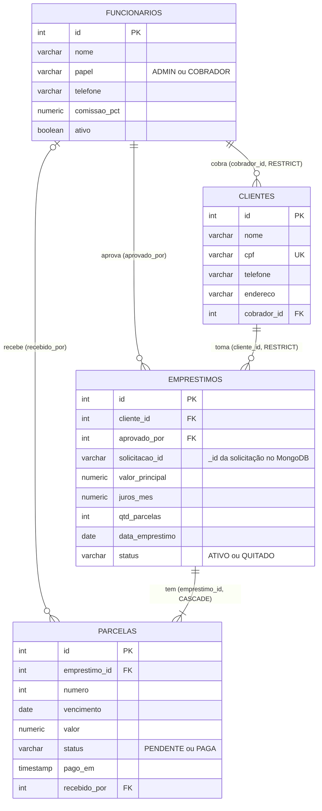

# Modelo ER (PostgreSQL)

Ligações com o MongoDB (não são FKs, são referências guardadas pela aplicação):

- `emprestimos.solicitacao_id` guarda o `_id` do documento em `solicitacoes`.
- `solicitacoes.emprestimo_id` guarda o `id` do empréstimo criado na aprovação.
- `ocorrencias_cobranca` guarda `emprestimo_id`, `cliente_id` e `cobrador_id` do PostgreSQL.
